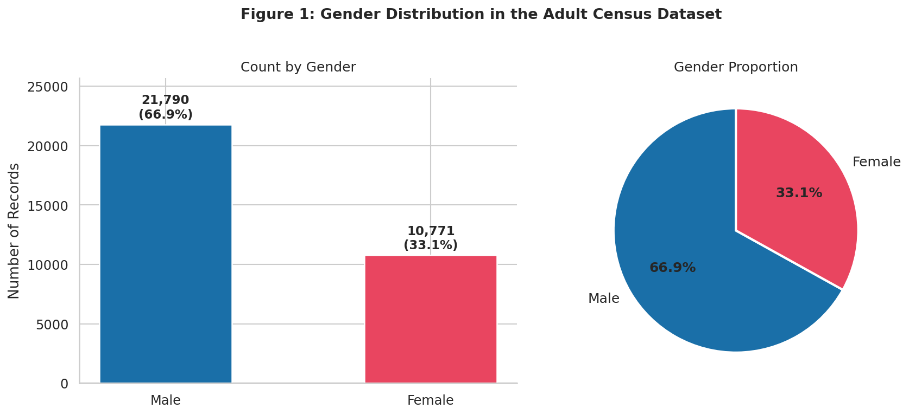
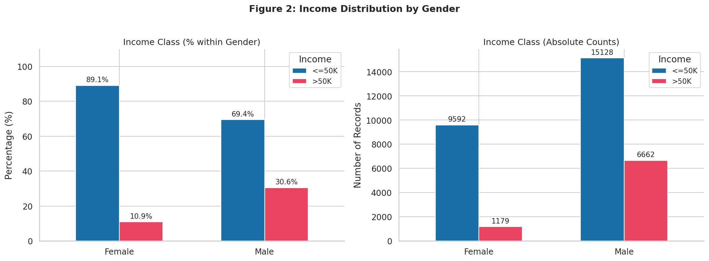
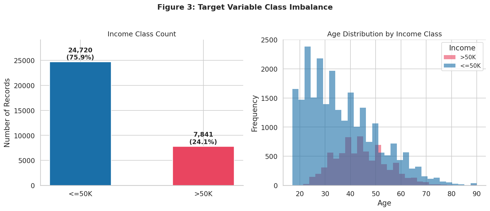
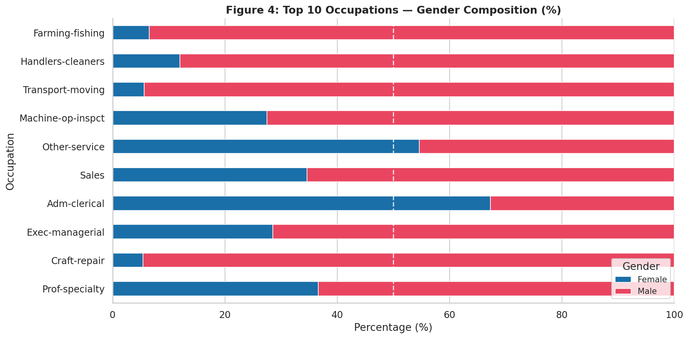
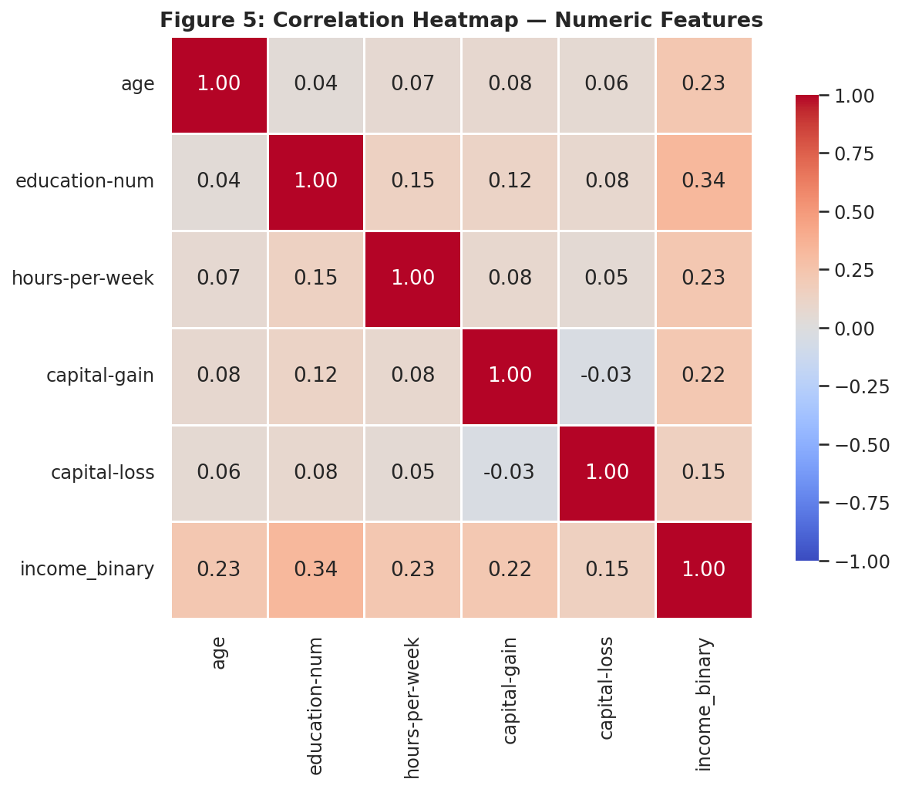
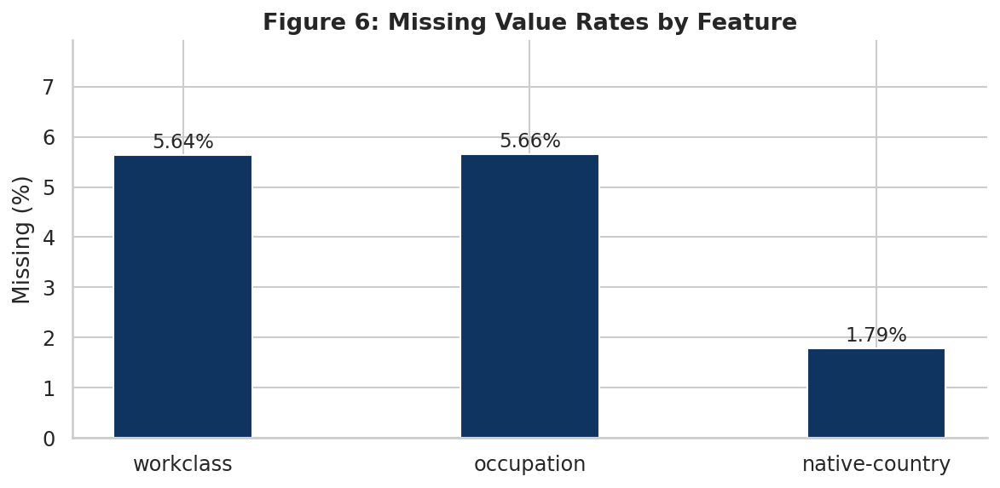

# Gender Bias Mitigation on UCI Adult Income (Reweighing vs SMOTE)

MSc AI project (National College of Ireland). Measures gender bias in a Random Forest income classifier and compares two mitigation strategies. Research and teaching use only.

## Data
UCI Adult (`adult.data`): 32,561 rows, 30,162 after dropping rows with missing values. The notebook downloads it from UCI on first run (internet needed). If the download fails, the notebook falls back to a synthetic stand-in dataset; the results below come from the real data.

## Method
- Random Forest (100 trees, max depth 12), stratified 80/20 split (24,129 train / 6,033 test), seed 42.
- Baseline, Reweighing (sample weights from P(sex) x P(income) / P(sex, income)), and SMOTE applied across the four (sex, income) subgroups, each oversampled to the size of the largest.
- Metrics: delta F1 = |F1 male - F1 female| for the >50K class, and the TPR gap between men and women (called "Equalized Odds Diff" in the notebook; it is the true-positive-rate gap only).

## Results

| Method | Accuracy | F1 (>50K) | F1 male | F1 female | Delta F1 | TPR gap |
|---|---|---|---|---|---|---|
| Baseline | 0.858 | 0.675 | 0.677 | 0.663 | 0.013 | 0.021 |
| Reweighing | 0.851 | 0.649 | 0.642 | 0.681 | 0.039 | 0.150 |
| SMOTE | 0.834 | 0.688 | 0.700 | 0.627 | 0.074 | 0.0005 |

- In the data, 30.6% of men and 10.9% of women earn >50K (2.79x).
- Neither mitigation reduced delta F1. Reweighing flipped the gap (female F1 above male) and widened the TPR gap.
- SMOTE nearly closed the TPR gap (about 98% reduction) but cost accuracy (85.8% to 83.4%) and precision (0.78 to 0.65), and female F1 fell.
- The fairness metrics disagree, so the choice of metric decides which method looks better.

## Limitations
- Single split and seed, no confidence intervals, so small differences may be noise.
- Only gender was mitigated. `sex` stays an input feature, and `relationship` (Husband/Wife) is a strong proxy for it.
- SMOTE interpolates over label-encoded categorical features (not SMOTENC), so synthetic rows can contain meaningless category values.
- 1994 US census data; only the `adult.data` split is used.

## Figures

## Exploratory analysis

## Run it
1. `pip install -r requirements.txt`
2. Run `bias_mitigation_uci_adult.ipynb` from top to bottom.

## References
- Becker, B. and Kohavi, R. (1996). Adult. UCI Machine Learning Repository.
- Kamiran, F. and Calders, T. (2012). Data preprocessing techniques for classification without discrimination. Knowledge and Information Systems.
- Chawla, N. et al. (2002). SMOTE: Synthetic Minority Over-sampling Technique. JAIR.
